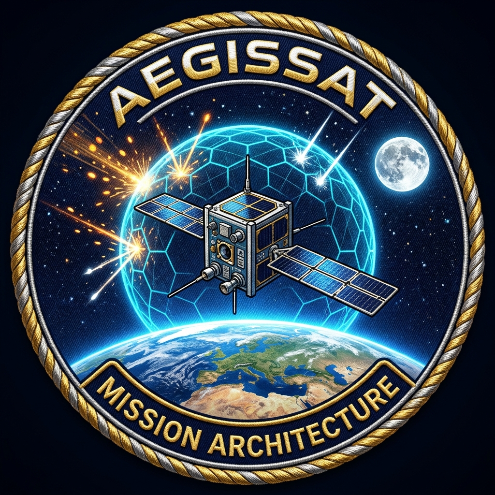

<p align="center">
  
</p>

# AegisSat — Space Mission Architecture Simulator

**NASA Space Apps Challenge 2026 — *Space Mission Design Game* (Universal Event)**  
Live Simulator: **[https://aegissat.space/](https://aegissat.space/)**  
Slides: **[English (EN)](demo/slides_en.html)** · **[Türkçe (TR)](demo/slides_tr.html)**  
Team Contact: **[info@aegissat.space](mailto:info@aegissat.space)** · **[NASA Space Apps Team](https://www.spaceappschallenge.org/2026/find-a-team/aegissat/?tab=details)**

---

## Overview

**AegisSat** is an interactive 3D CubeSat mission architecture simulator uniting **TRL-7 stratospheric flight heritage** from **KÜPSAT-01**, peer-reviewed **IAC 2026 Antalya** structural optimization (`IAC-26-C2.IPB.29`), and **WERR 24-Byte 0-SRAM** SEU-immune avionics with **Negative Schwarzian / Koenigs ADCS detumbling**.

- **KÜPSAT-01 Flight Heritage (7 Aug 2026, Mersin):** 25.64 km peak altitude, 22.51 hPa, -54.50 °C ambient (+37.23 °C passive thermal delta), 20G burst shock, and 3,647.58 °/s tumbling telemetry ([Flight Report](https://teknosanat.com.tr/lib/cubesat/cubesat_master_flight_report_tr.html) · `data/kupsat01_flight_20260807.csv`).
- **IAC 2026 Hybrid Shield (`IAC-26-C2.IPB.29` / `TPMK 2025/007159`):** 345 g 1U chassis (`AA7075-T6 + Toray T700 CFRP + Rigid 10K Ceramic + XPS`), 81.7% Von Mises stress reduction (`100.87 -> 18.49 MPa`), `100.76 Hz` primary mode, `FS = 27.20`.
- **WERR 24-Byte 0-SRAM & ADCS:** 0 B mutable weight SRAM (72 B full TMR PROM), `192/192` CRC-16/CCITT-FALSE single-bit SEU detection, and `94.37%` 10-cycle detumbling energy damping (`S(f)(0) <= -6.9196 < 0`, `mu = 0.75`).

## Quickstart & Verification

```bash
python -m unittest discover -s tests -v
```

## Team Members

- **Bekirhan Dagli** (`@bdagli`) — Team Owner
- **Burak Salar** (`@pcfox`) — Aerospace & Mechatronics Systems Engineer
- **Emrah Yurtseven** (`@eyurtseven`) — Maritime & Space Cybernetics

## Super Intelligence (SI) Transparency Disclosure

In accordance with NASA Space Apps Challenge 2026 SI guidelines, mission patch artwork (`assets/aegissat_mission_patch.jpg`) and code scaffolding were developed with AI/SI assistance without incorporating any NASA logos, flags, or official emblems. All telemetry calculations, 24-byte CRC-16 framing, and Python ↔ JavaScript parity are verified by `tests/test_aegissat_core.py`.
